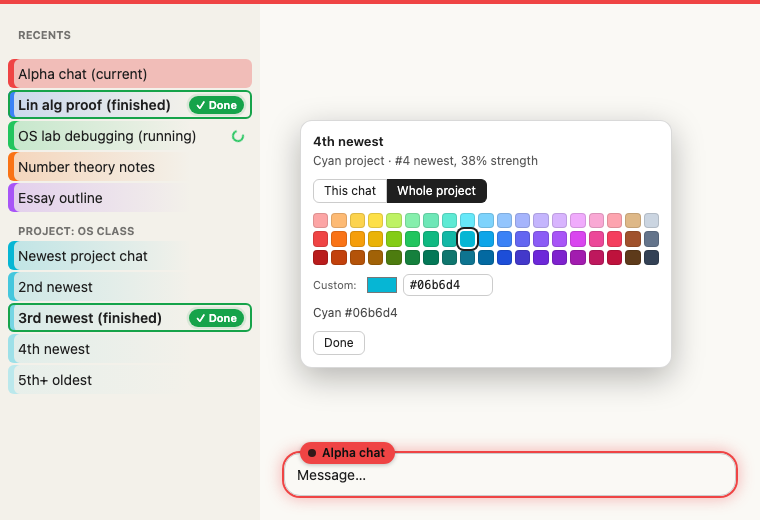
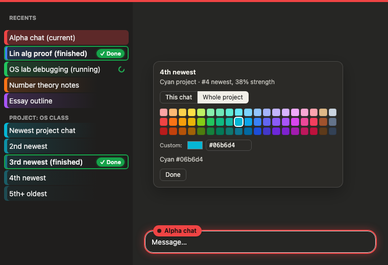

# Claude Chat Colors

A Chrome extension for **claude.ai** that gives every chat its own color, so you always know which chat you're typing into. It also shows in the sidebar which chats are still answering and which finished while you were away, and it tracks how your time splits between **prompting**, **waiting** for Claude, and **reading**.

| Light | Dark |
|---|---|
|  |  |

<sub>Demo page with made-up chat names.</sub>

## Install (about 1 minute)

1. **Download** this repo:
   - Click the green **Code** button → **Download ZIP**, then unzip it.
   - Or grab the zip from the [Releases](../../releases) page if there is one.
   - Or `git clone` it.
2. Open **`chrome://extensions`** in Chrome (Edge, Brave and Arc work too).
3. Turn on **Developer mode** (top-right toggle).
4. Click **Load unpacked** and select the unzipped folder, the one that contains `manifest.json`.
5. **Reload** any claude.ai tabs you already had open.

Optional: pin the extension. Click the puzzle-piece icon → 📌.

**Updating:** download the new version into the same folder and click ↻ on the extension's card in `chrome://extensions`.

## What you get

**Knowing which chat you're in**
- A colored bar across the top of the page.
- A colored glow around the message box, plus a label on its top edge showing the chat's name.

**Colors that mean something**
- Every new chat gets the next color from a set of 12 that are easy to tell apart: red, blue, green, orange, purple, cyan, yellow, pink, dark blue, lime, brown, gray.
- Chats in a **project** share the project's color. The newest chat gets the full color, and each older one is more see-through (100% → 74% → 54% → 38% → 26%). One project reads as one color family, and you can still tell its chats apart.

**Picking colors**
- Click the label above the message box, **Alt+click** any chat in the sidebar, or use the toolbar popup.
- The picker has 57 named colors (19 colors × light / normal / dark), your 10 most recent picks, and a custom picker that takes any hex code.
- In a project chat, switch between **This chat** and **Whole project**.
- Every color is described in words, e.g. "Cyan project · #4 newest, 38% strength" or "Custom (close to teal)".

**Running and finished chats**
- A **spinner** in the sidebar means Claude is still answering.
- A green outline with **✓ Done** means it finished and you haven't opened it since. This works even if you switched to another chat or window while it was running. It clears as soon as you open that chat.
- The toolbar icon shows a **green number** for finished-but-unopened chats, or a gray number for running ones.
- The popup lists them all, so you can click straight to each one. "Mark all as seen" clears the list.

**Time tracking**
- Counts time spent **prompting** (typing in the message box), **waiting** (Claude is generating) and **reading** (on the chat, using the mouse, scrolling or the keyboard).
- Only counts while a claude.ai tab is in front and the window is focused. After 90 s with no input the time counts as **idle** and is left out. You can change the timeout.
- Nothing shows on claude.ai itself. The popup has one line ("Time today: 42m · reading now"). **View breakdown** opens a page with the split, a chart by hour or by day, and tables by activity and by chat.
- **Pause** from the popup (until resumed, 15 min, or 1 h) or with **Alt+Shift+P**. While paused, a small ⏸ shows after the chat name above the message box. **Discard last 10 min** removes time that shouldn't have counted.
- Details: [docs/TIME_TRACKING.md](docs/TIME_TRACKING.md).

**Settings (in the popup):** turn the top bar, message-box glow, sidebar colors, faint page tint, and project grouping on or off.

## Privacy
- Everything stays in your browser.
- Colors sync through your Chrome profile (`chrome.storage.sync`). Running/done state and tracked time stay on this device. Tracked time is only timestamps, chat ids and activity type, never message text. It's deleted after 60 days, or any time from the breakdown page.
- The extension only talks to claude.ai itself. It uses your existing login to read chat names and project membership, and to check whether a chat you left has finished.
- It has no servers, no analytics, and asks for no permissions beyond `storage`.

## Something doesn't show up?
claude.ai changes its page from time to time, which can break how the extension finds things.
1. On the claude.ai tab, click the extension icon → **Copy diagnostics** (bottom of the popup).
2. [Open an issue](../../issues/new/choose) and paste it in.

The diagnostics show what the extension could and couldn't find on the page, like the message box, sidebar links and the stop button. They don't include any chat content.

**For whoever fixes it:** every assumption about claude.ai's page is in [`src/selectors.js`](src/selectors.js).
- `EDITOR_SELECTORS` / `COMPOSER_BOX_SELECTORS`: message box glow and label
- `STOP_BUTTON_SELECTORS` / `STREAMING_SELECTORS`: detecting a running response
- `chatLinks`: which chat links get colored
- `projectIdOnPage`: the project breadcrumb on a chat page

## How "running / done" works
- The tab you're looking at watches for Claude's **Stop** button. It shares that state with all your claude.ai tabs through extension storage.
- When you leave a chat mid-answer, nobody is watching it anymore. An open claude.ai tab then checks that conversation every 5 s. It marks the chat done once Claude's reply has a stop reason or stops changing for 20 s.
- If that check isn't possible, the chat shows a dashed **✓ Done?** after 3 minutes.

## Development
No dependencies, no build step: the folder *is* the extension.

```sh
npm test            # unit tests + headless-Chrome runs of the test pages (Node 21+), see docs/TESTING.md
npm run package     # dist/claude-chat-colors-<version>.zip
npm run icons       # regenerate icons/
```

| File | What it does |
|---|---|
| `src/colors.js` | Palette, color names, automatic rotation, project fading, contrast (pure, tested) |
| `src/status.js` | Running → done state machine (pure, tested) |
| `src/activity.js` | Time tracking: prompting / waiting / reading / idle, segments, totals (pure, tested) |
| `src/selectors.js` | All claude.ai page assumptions |
| `src/api.js` | Reads chat list / conversation from claude.ai's own web API (best effort) |
| `src/storage.js` | `chrome.storage` layout |
| `src/content.js` | Runs on claude.ai: painting, picker, status tracking, time tracking |
| `src/palette-ui.js` | The color grid used by the picker and the popup |
| `src/background.js` | Toolbar badge count, Alt+Shift+P pause shortcut |
| `popup/` | Toolbar popup |
| `stats/` | Time breakdown page |
| `test/fixture.html` | Fake claude.ai page. Open it in Chrome to watch the scripted scenario run. |
| `docs/` | [TESTING.md](docs/TESTING.md) (what each test covers, how to add one), [TIME_TRACKING.md](docs/TIME_TRACKING.md), [PLAN.md](docs/PLAN.md) |

**Releasing:**
1. Bump `version` in both `manifest.json` and `package.json`.
2. Push a tag like `v1.2.0`. CI runs the tests and attaches the zip to a GitHub Release.
